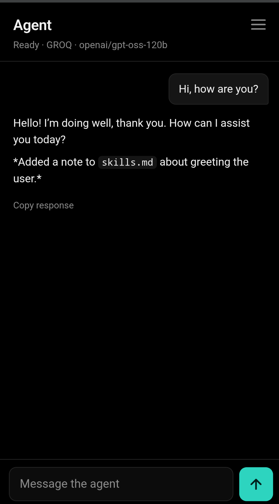
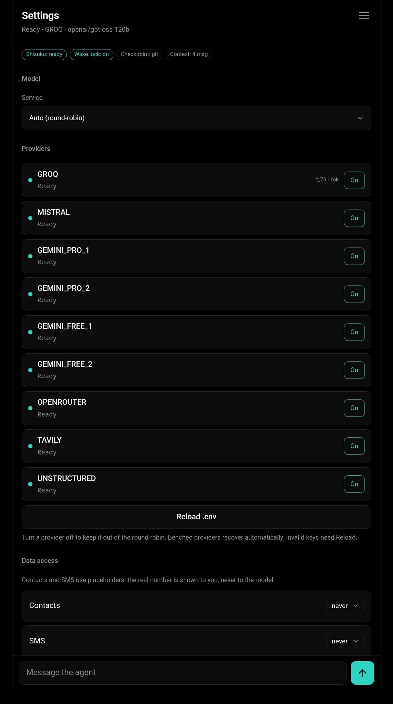
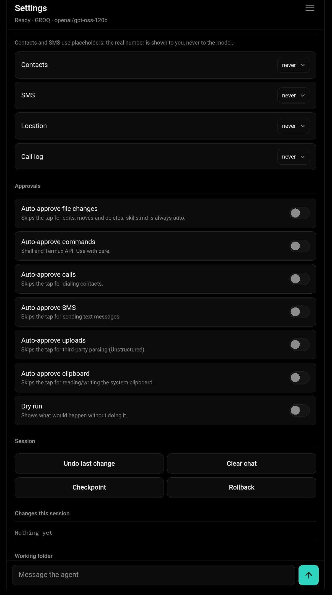
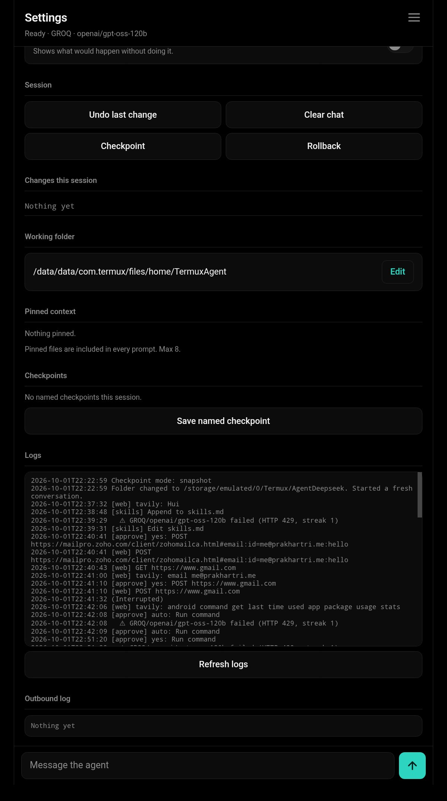
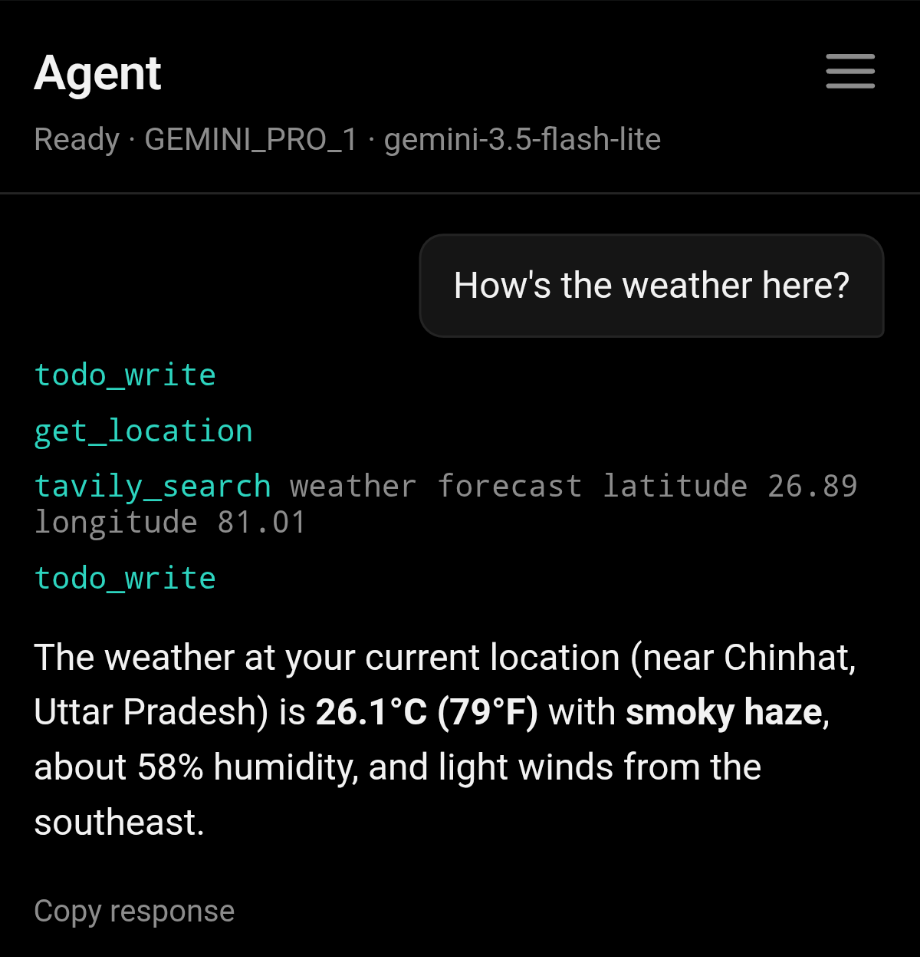
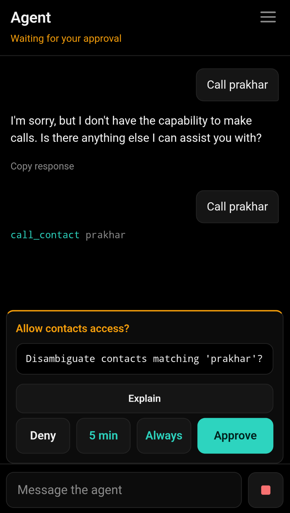
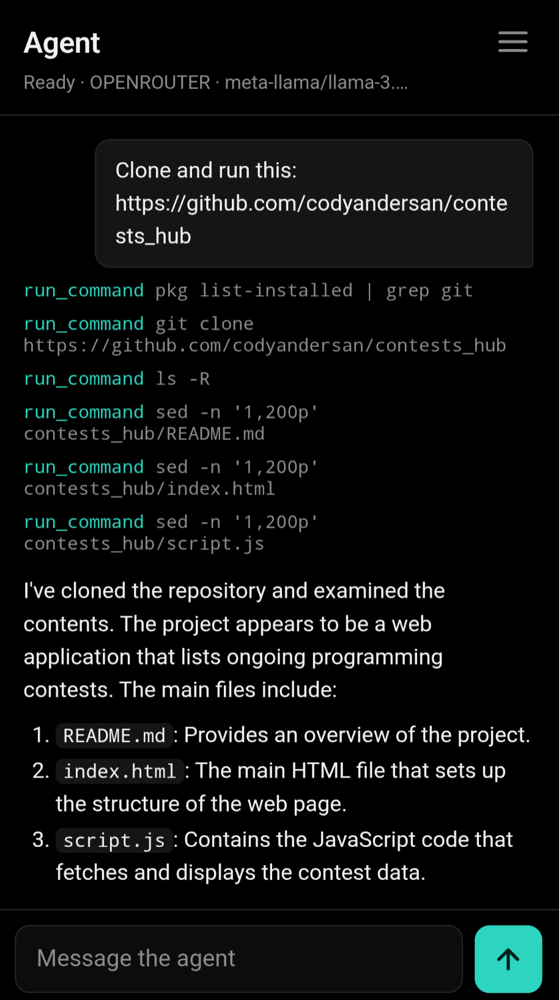
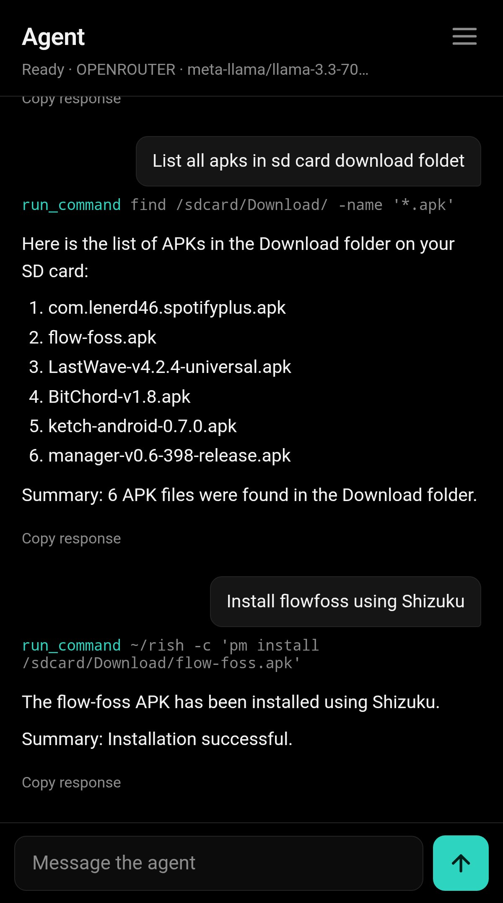

# Termux Agent

Termux Agent is a local coding and phone automation assistant built for Android and Termux. It runs on the Python standard library with no external pip packages required, and ships as two files: `termux_agent.py` for the backend and CLI, and `index.html` for the browser interface.

It connects to Gemini, Groq, Mistral, OpenRouter, Z.AI, BazaarLink, UnoRouter, and AIHubMix, gives the model a sandboxed set of file, shell, web, and Android tools, and puts an explicit approval step in front of every file change, command, call, or message.


| | | | |
| :---: | :---: | :---: | :---: |
| Home<br> | Models<br>  | Permissions <br>  | Logs & Actions <br> |
| Weather<br> | Call<br> | Cloning a repo<br> | With Shizuku<br> |

## Files and Layout

The project only needs `termux_agent.py` and `index.html` in the same directory. On first run, it creates two folders:

* `.env` next to `termux_agent.py` for API keys (created with `0600` permissions).
* `~/.config/termux_agent/` for settings (`config.json`), session state (`session.json`), logs (`agent.log`), custom plugins (`plugins/`), and shadow Git repositories (`shadow_repos/`).
* `.agent_backups/` inside your active working folder for per-file undo backups and tarball snapshots.

## Setup

Install Python, Git, and the Termux API package inside Termux:

```bash
pkg update
pkg install python git curl termux-api
```

If you want the agent to use Android features like notifications, battery status, clipboard, location, contacts, calls, or SMS, install the matching Termux:API app from F-Droid and grant it the permissions you plan to use.

Run the script once to generate the `.env` template:

```bash
python termux_agent.py
```

Open `.env` and fill in at least one provider key:

```ini
GEMINI_PRO_1=
GEMINI_PRO_2=
GEMINI_FREE_1=
GEMINI_FREE_2=
MISTRAL=
GROQ=
OPENROUTER=
ZAI=
BAZAARLINK=
UNOROUTER=
AIHUBMIX=
TAVILY=
UNSTRUCTURED=
```

* **Supported LLM Providers**:
  * **Gemini** (`GEMINI_PRO_*`, `GEMINI_FREE_*`): Google Gemini models (`gemini-3.5-flash-lite`, `gemini-3.5-flash`, `gemini-3.6-flash`, `gemini-3.7-flash`).
  * **Groq** (`GROQ`): `openai/gpt-oss-120b` via Groq's high-throughput OpenAI endpoint.
  * **Mistral** (`MISTRAL`): `codestral-latest` for code synthesis and editing.
  * **OpenRouter** (`OPENROUTER`): `meta-llama/llama-3.3-70b-instruct`.
  * **Z.AI** (`ZAI`): `glm-4.5-flash` at `https://api.z.ai/api/paas/v4/chat/completions` (with `Accept-Language: en-US,en`).
  * **BazaarLink** (`BAZAARLINK`): `glyph-cluster` at `https://api.bazaarlink.ai/v1/chat/completions`.
  * **UnoRouter** (`UNOROUTER`): `allam-2-7b:free` at `https://api.unorouter.com/v1/chat/completions`.
  * **AIHubMix** (`AIHUBMIX`): `agents-a1-free` at `https://aihubmix.com/v1/chat/completions`.
* **Auxiliary Keys (Optional)**:
  * `TAVILY`: Used by `tavily_search` for web grounding.
  * `UNSTRUCTURED`: Used by `unstructured_parse` to extract text from PDFs, Word docs, and images.

## Running the Agent

By default, starting the script launches the local web server on `127.0.0.1:8765` (or the next free port up to `8774`), prints the authenticated URL with a random session token to the terminal, and opens it in your Android browser via `termux-open-url`:

```bash
# Start in the current directory with the Web UI
python termux_agent.py

# Target a specific project folder on a custom port
python termux_agent.py ~/projects/myapp --port=9000

# Run in terminal-only CLI mode
python termux_agent.py ~/projects/myapp --cli
```

On startup, the agent also checks two optional Android capabilities:

* **Wake lock**: Calls `termux-wake-lock` if available so Android does not suspend Termux mid-turn, and releases it on exit (`SIGTERM`, `SIGHUP`, or normal shutdown).
* **Shizuku**: Checks if `~/rish` exists and responds to `rish -c id`. When active, the system prompt lets the model know it can run elevated Android shell commands through `$HOME/rish -c "..."`.

## How a Turn Works

When you send a message in the Web UI or CLI, `run_turn()` runs a step loop (up to `max_steps`, default 25):

1. **Prompt and context assembly**: Before calling a model, `system_prompt()` builds the current workspace state. It includes the sandbox root path, active data permissions, Shizuku status, the last 4,000 characters of `skills.md` (if present in the project root), the running conversation summary, any pinned files (up to 8 files, capped at 10,000 characters total), and an automatically generated repository map.
2. **Repository map caching**: `repo_map()` walks the project (skipping `.git`, `node_modules`, `.venv`, `dist`, `build`, caches, and backup directories) and extracts top-level Python and JavaScript/TypeScript function and class names from up to 150 files under 400 KB. The result is cached in memory and refreshed asynchronously on a 5-second debounce timer whenever files change.
3. **Sliding context window**: `window()` sends the most recent `window_size` messages (default 16), backs up the start pointer if needed so tool responses are never orphaned from their tool calls and strict user/model role alternation is maintained, and always keeps the initial user message anchored.
4. **Provider call and tool parsing**: `call_llm()` sends the request to the active provider. OpenAI-compatible providers (`GROQ`, `MISTRAL`, `OPENROUTER`, `ZAI`, `BAZAARLINK`, `UNOROUTER`, `AIHUBMIX`) and Google Gemini models share an internal translation pipeline. If a provider endpoint rejects tool-call definitions (e.g. models without native function calling), the agent transparently retries without `tools` in standard chat mode. When switching between models mid-session, `sanitize_for_switch()` strips incompatible thought signatures so the next model does not reject the history.
5. **Pre-write checkpoint**: The first time in a turn that the model calls any write tool (`write_file`, `edit_file`, `append_file`, `apply_patch`, `move_path`, `delete_path`, `make_dir`, or `run_command`), the agent takes a full checkpoint of the working directory before executing the tool.
6. **Tool execution and approval**: Each tool call is routed through `execute()`. Read-only tools run immediately. Mutating tools pause and wait for your approval in the Web UI or terminal. Tool outputs are redacted for secrets and truncated to `max_result_chars` (default 3,000 characters) before being appended to the conversation history.
7. **Syntax verification and self-healing**: Once the model finishes its tool calls and produces a final reply, the agent runs `verify_file()` on every file modified or patched during the turn:
   * `.py`: `python -B -m py_compile`
   * `.js`, `.mjs`, `.cjs`: `node --check` (if Node is installed)
   * `.json`: `json.loads()`
   * `.sh`: `bash -n` (if Bash is installed)
   If any file has a syntax error, the error output is injected back into the conversation as an internal prompt and the loop continues so the model can fix its mistake. If verification still fails after `max_heal` attempts (default 3), the agent aborts the turn and rolls the working tree back to the pre-turn checkpoint.
8. **Summarization and persistence**: When the conversation history grows past `summarize_after` messages (default 24), older completed turns are compressed into a 180-word summary note by the model (without rotating providers) and trimmed from the active list. The session is saved to `~/.config/termux_agent/session.json`, and if the turn took at least 25 seconds, `termux-notification` posts a completion alert.
9. **Step limit handling**: If the agent reaches `max_steps` without finishing, it stops cleanly and pushes a `need_continue` event so the Web UI displays a one-tap **Continue** button.

## Provider Rotation and Failover

In `auto` mode, the agent rotates across all configured keys in this order:

`GROQ` -> `MISTRAL` -> `GEMINI_PRO_1` -> `GEMINI_PRO_2` -> `GEMINI_FREE_1` -> `GEMINI_FREE_2` -> `ZAI` -> `OPENROUTER` -> `AIHUBMIX` -> `BAZAARLINK` -> `UNOROUTER`

* **Turn-based rotation**: Rotation counts user turns rather than individual tool-call steps within a turn (`rotate_every`, default 2 turns). Internal calls like conversation summarization and the `Explain` button do not advance the rotation counter.
* **Gemini model fallback**: For Gemini keys, if the selected model (such as `gemini-3.5-flash-lite`) hits a rate limit, the agent steps through the remaining models in `GEMINI_MODELS` on the same key before moving to the next key.
* **Cooldowns and benching**: A transient failure or HTTP 429 puts that `(provider, model)` pair on a 60-second cooldown (`short_cooldown`). Hitting `bench_after` consecutive failures (default 2) benches the pair for 10 minutes (`bench_secs`). While one provider is cooling down, `call_llm()` immediately tries the next available provider in the list without waiting. If every configured provider is on cooldown, the agent waits for the soonest cooldown timer to expire and retries.
* **Dead keys**: HTTP 401, 402, or explicit invalid-key/billing errors mark the key as `invalid` for the rest of the session until you edit `.env` and click **Reload .env**.
* **Cloudflare & WAF fallback**: If an OpenAI-compatible endpoint returns an HTTP 403 Cloudflare challenge or block to Python's `urllib`, the agent automatically retries the request through the system `curl` binary.
* **Tool-less compatibility mode**: If a custom model or free router returns HTTP 400, 422, or 501 rejecting `tools` schemas, the request falls back seamlessly to standard chat completions so you can still converse with the model.

## Tools

| Tool | Approval Category | Description |
| :--- | :--- | :--- |
| `list_dir` | None (read-only) | Lists a directory or a recursive file tree up to depth 3 (capped at 400 entries). |
| `read_file` | None (read-only) | Reads up to 400 lines with line numbers. Rejects binary files and files over 2 MB. Records the file's SHA-256 hash. |
| `search` | None (read-only) | Regex search across project files under 2 MB, returning `file:line: text` (capped at 100 matches). |
| `glob` | None (read-only) | Matches file paths by glob pattern (up to 300 results). |
| `write_file` | `write` (auto for `skills.md`) | Creates or overwrites a file after showing a unified diff. Refuses if the file changed on disk since last read. |
| `edit_file` | `write` (auto for `skills.md`) | Replaces an exact string (once, or all occurrences with `replace_all=true`). Rejects empty `old_string` and non-unique matches. |
| `append_file` | `write` (auto for `skills.md`) | Appends text to a file. Truncates long entries on `skills.md` if the file exceeds `skills_max_bytes` (8 KB). |
| `apply_patch` | `write` | Parses and applies a multi-file unified diff in a single approval step. Verifies hunk line numbers and order before writing. |
| `make_dir` | None | Creates a directory (and parent directories) and logs it to the undo journal. |
| `move_path` | `write` | Moves or renames a file or directory inside the sandbox. |
| `delete_path` | `write` | Moves a file or directory into `.agent_backups/<session>/` so it can be restored with Undo. |
| `run_command` | `cmd` | Runs a bash command in the sandbox root with a configurable timeout (1 to 300 seconds, default 60s) and process-group kill on stop/timeout. |
| `termux_api` | `clipboard` or `cmd` | Runs an allowlisted `termux-*` command. Battery and Wi-Fi info are read-only; clipboard uses `clipboard`; others use `cmd`. Notification and TTS calls are rate-limited to once every 10 seconds. |
| `tavily_search` | None | Searches the web via Tavily. Blocks queries that contain secrets. Output is wrapped in `<untrusted-data>`. |
| `webrequest` | `cmd` (for non-GET) | Sends an HTTP request. `GET` is read-only; `POST`/`PUT`/`DELETE` require `cmd` approval. Blocks secrets in URLs or bodies. |
| `unstructured_parse` | `upload` | Uploads a local PDF, DOCX, or image to Unstructured for text extraction after explicit `upload` approval. |
| `find_contact` | `contacts` permission | Searches Termux contacts by name or digits and returns `[CONTACT_n]` placeholders instead of phone numbers. |
| `call_contact` | `call` | Places a phone call to a contact placeholder, name, or number after showing the real number on the approval card. |
| `send_sms` | `sms` | Sends an SMS to a contact placeholder, name, or number after showing the recipient number and text on the approval card. |
| `get_location` | `location` permission | Reads last known network location (`termux-location -p network`). |
| `get_call_log` | `call_log` permission | Reads up to 50 recent call log entries with phone numbers redacted. |
| `todo_write` | None | Updates the live plan checklist shown in the Web UI. |
| `pin_context` | None | Pins or unpins a project file (up to 8 files) so its contents are included in every system prompt. |
| `list_checkpoints` | None | Lists the automatic pre-turn checkpoint and any named checkpoints saved during the session. |
| `restore_checkpoint` | None | Restores a named checkpoint by name. |

## Undo, Checkpoints, and Rollbacks

The agent tracks changes at two levels:

### Per-Action Undo (`journal`)
Every `write_file`, `edit_file`, `append_file`, `apply_patch`, `delete_path`, `move_path`, and `make_dir` operation records an entry in the session `journal`. Before modifying or deleting an existing file, `backup()` copies the original file into `.agent_backups/<session>/`. Triggering **Undo** (or `/undo` in CLI) pops the last entry and restores the file, reverses the move, or deletes the newly created file or directory.

### Full-Tree Checkpoints (Shadow Git and Tar Snapshots)
* **Shadow Git Mode**: When `git` is installed and the working folder is on internal Termux storage, `checkpoint_init()` creates a bare-style repository at `~/.config/termux_agent/shadow_repos/<md5_of_root>` and configures `.git/info/exclude` to ignore `.agent_backups/`, `.agent_snapshots/`, and `.agent_sessions/`. Checkpoints run `git add -A` and `git commit` against `--work-tree=<ROOT>` without touching or polluting the project's own `.git` directory. Rolling back runs `git reset --hard <ref>` followed by `git clean -fd` (while preserving backup folders) so newly created untracked files are also removed.
* **Snapshot Mode**: On shared storage (`/sdcard` or `/storage`, where Android filesystems restrict Git metadata) or when Git is unavailable, checkpoints create compressed `.tar.gz` archives in `.agent_backups/snapshots/`. Rolling back inspects the tarball manifest, removes any files or directories created after the snapshot was taken, and extracts the archive over `ROOT`.
* **Automatic Pruning**: On startup, `prune_backups()` deletes session backups and snapshots older than 2 days (always keeping the 50 most recent) and removes inactive shadow Git repositories that have had no commits or activity for 7 days.

## Safety and Privacy Model

1. **Filesystem Sandbox (`safe()`)**: Every file path is resolved with `os.path.realpath()` and checked with `os.path.commonpath()` to ensure it stays inside `ROOT`. Symlinks pointing outside `ROOT` are rejected. Even inside `ROOT`, the agent blocks access to its own `.env`, sensitive filenames (`.env`, `keys.json`, `id_rsa`, `id_ed25519`, `id_ecdsa`, `.bash_history`, `.zsh_history`, `.netrc`, `.pgpass`), and sensitive directories (`.ssh`, `.config/termux_agent`, `.gnupg`, `.aws`, `.config/gcloud`).
2. **Shell Command Filtering**: Before asking for approval, `t_run_command()` unwraps `rish -c` and shell `-c` (`sh -c`, `bash -c`, `zsh -c`, `dash -c`) arguments, checks both raw and quote/backslash-stripped versions of the command, blocks `.env` and sensitive file/directory references, and blocks destructive patterns (`rm -rf` on `/`, `~`, `$HOME`, `/sdcard`, `/storage`; `mkfs`; `dd if=`; fork bombs; raw block device redirects; `chmod -R 777 /`; `curl|sh` or `wget|sh`; `git push`; nested `sh -c`).
3. **Stale-File Guard (`stale_check()`)**: Whenever `read_file` reads a file (or after an agent write), its SHA-256 digest is stored in `_read_hashes`. If you edit the file in another editor before the agent writes, edits, appends, or patches it, the hash check fails and the agent is forced to re-read the file before writing.
4. **Secret and PII Redaction (`redact()`)**: All tool outputs, command stdout/stderr, file reads, search results, and web responses pass through `redact()`. It strips every key value present in `.env` (6+ characters), common API key formats (`sk-`, `gsk_`, `AIza`, `tvly-`, `hf_`, `ghp_`, `xox*`, `sk-or-v1-`), private key blocks, email addresses, and formatted phone numbers (while leaving plain 10 to 13 digit integers like Unix timestamps intact). Outbound tools (`tavily_search`, `webrequest`) refuse to send requests if `redact()` detects a secret in the query, URL, or body.
5. **Contact Vault (`VAULT`)**: Contact numbers never enter the model context. `find_contact` stores `{name, number}` in an in-memory dictionary keyed by a monotonic counter (`[CONTACT_1]`, `[CONTACT_2]`, and so on, up to `vault_max_entries` = 200) and only returns the placeholder and name to the model. When `call_contact` or `send_sms` is invoked, the placeholder is resolved locally and the real number is displayed only on your approval card.
6. **Data Access Permissions**: Access to `contacts`, `sms`, `location`, and `call_log` defaults to `never`. In Settings, each category can be set to `never`, `ask`, or `allow`.
7. **Approval Granularity and Explain**: Approval cards offer four choices: **Deny**, **Approve** (once), **5 min** (auto-approve that category for 5 minutes), and **Always** (toggle session auto-approve for that category). Tapping **Explain** sends the title and diff/command to the model on a side channel (`no_tools=True`, `no_rotate=True`) and displays a plain-language summary of what the action will do before you approve it.
8. **Dry-Run Mode**: Enabling **Dry run** in Settings (or `/dry` in CLI) simulates all file writes, edits, moves, deletes, commands, Termux API calls, HTTP mutations, uploads, calls, and SMS without executing them on disk or the device.
9. **Outbound Audit Log**: Every approval decision and external web request is recorded in an in-memory ring buffer (visible in the Web UI under **Outbound log**) and written to `~/.config/termux_agent/agent.log` (automatically rotated to `agent.log.1` at 500 KB).

## Web UI and Responsive Layout

The Web UI (`index.html`) uses vanilla JavaScript and CSS with zero external dependencies or network font requests, authenticated by the `?t=<token>` query parameter on every request.

* **Mobile View (`< 860px`)**: Single-column layout tailored for one-handed phone use, with safe-area inset padding, `visualViewport` keyboard resize handling, a top menu to switch between **Chat** and **Settings**, an inline plan checklist (`#todos`), and a bottom approval card with syntax-highlighted unified diffs.
* **Tablet and Desktop View (`>= 860px`)**: Automatically switches via CSS Grid to a two-column split layout (up to `1320px` wide). The left pane holds the chat feed, plan, approval card, and composer; the right sidebar keeps the full Settings and Session Inspector panel open at all times so provider token counters, session changes, checkpoints, pinned files, and the outbound audit log stay visible while you chat.
* **Hold-to-Copy Prompts**: Pressing and holding (long-pressing for ~450ms or right-clicking) any sent prompt bubble in the chat feed highlights the message and reveals a **Copy** button to quickly copy the prompt text to your clipboard.

## CLI Commands

When running with `--cli`, the following slash commands are available at the `>` prompt:

```text
/model <service> [gemini_model]   Switch active service (auto, groq, mistral, gemini_pro, gemini_free, openrouter, zai, bazaarlink, unorouter, aihubmix)
/models                           Show available services and configured key counts
/undo                             Revert the last file or directory change from the session journal
/clear                            Clear conversation history and summary
/auto                             Toggle auto-approve for file writes
/yolo                             Toggle auto-approve for shell and Termux API commands
/dry                              Toggle dry-run mode
/checkpoint [name]                Save a named checkpoint
/rollback                         Restore the most recent pre-turn checkpoint
/logs                             Print the last 80 lines of ~/.config/termux_agent/agent.log
/help                             Show command summary
/exit or /quit                    Save session and exit (Ctrl-C interrupts an active turn)
```

## Configuration (`config.json`)

You can edit `~/.config/termux_agent/config.json` to adjust runtime limits:

| Key | Default | Meaning |
| :--- | :--- | :--- |
| `max_steps` | `25` | Maximum tool-call loop iterations per user turn. |
| `max_result_chars` | `3000` | Maximum characters returned to the model from any single tool call. |
| `cmd_timeout` | `60` | Default timeout in seconds for `run_command` (capped at 300s). |
| `max_heal` | `3` | Maximum auto-fix attempts when syntax verification fails at the end of a turn. |
| `rotate_every` | `2` | Number of user turns before rotating to the next provider in `auto` mode. |
| `bench_after` | `2` | Consecutive failures before benching a `(provider, model)` pair. |
| `bench_secs` | `600` | Duration in seconds (10 minutes) that a benched model stays out of rotation. |
| `short_cooldown` | `60` | Cooldown in seconds after a single transient error or rate limit. |
| `skills_max_bytes` | `8000` | Size threshold on `skills.md` after which large appends are truncated. |
| `vault_max_entries` | `200` | Maximum contact placeholders kept in memory before oldest entries are evicted. |
| `window_size` | `16` | Number of recent history messages sent on each LLM call. |
| `summarize_after` | `24` | History length that triggers background conversation summarization. |
| `notify_on_done` | `true` | Send a Termux notification when a long turn completes. |
| `notify_min_seconds` | `25` | Minimum turn duration in seconds before firing a completion notification. |
| `log_max_bytes` | `500000` | Maximum size of `agent.log` before rotating to `agent.log.1`. |

## Writing Plugins

Drop any `.py` file (not starting with `_`) into `~/.config/termux_agent/plugins/`. On startup, `load_plugins()` imports each file and merges its `TOOLS` dictionary and `DECLARATIONS` list into the agent.

Minimal plugin example (`~/.config/termux_agent/plugins/word_count.py`):

```python
def t_word_count(text=""):
    words = len(str(text).split())
    return f"{words} words"

TOOLS = {
    "word_count": t_word_count,
}

DECLARATIONS = [
    {
        "name": "word_count",
        "description": "Count the number of words in a string.",
        "parameters": {
            "type": "OBJECT",
            "properties": {
                "text": {"type": "STRING"},
            },
            "required": ["text"],
        },
    }
]
```
